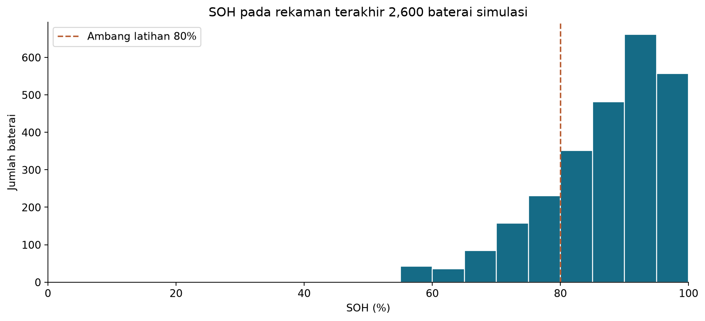
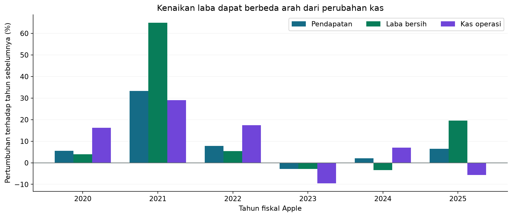

# Visualisasi Data dan Informasi Strategis

Tugas Sub Riset Data untuk dataset nomor **2 dan 3**: kesehatan baterai kendaraan listrik dan fundamental Apple. Analisis menggunakan Python, pandas, serta matplotlib dalam notebook Jupyter.

Setiap notebook memuat pemeriksaan kualitas data, alasan pemilihan visualisasi, hasil pengolahan, penjelasan **informasi**, dan **informasi strategis** yang terkait dengan tujuan skenario.

## Notebook utama

| Tugas | Notebook | Cakupan |
|---|---|---|
| 2 | [Kesehatan baterai EV](RISET30OKTOBER/Analisis/02_battery_visualisasi.ipynb) | 50.000 observasi sintetis, 2.600 baterai, distribusi SOH, hubungan siklus, perbandingan kelompok, dan skrining ilustratif |
| 3 | [Fundamental Apple](RISET30OKTOBER/Analisis/03_apple_visualisasi.ipynb) | Pendapatan, margin laba, dan arus kas tahun fiskal penuh 2019–2025 |

Output tabel dan grafik sudah tersimpan di notebook sehingga dapat dibaca tanpa menjalankan ulang kode.

## Contoh visualisasi

### Kesehatan baterai



Median SOH pada rekaman terakhir per baterai adalah 89,26%. Aturan SOH < 80% atau label risiko High menghasilkan 579 kandidat pemeriksaan dari 2.600 baterai. Itu merupakan hasil skrining pada simulasi, bukan kegagalan terkonfirmasi.

Informasi strategis dalam skenario ini adalah perlunya memperkirakan kapasitas inspeksi berdasarkan kondisi baterai dan pilihan ambang, dengan validasi data nyata sebelum penerapan.

### Fundamental Apple



Pada FY2025, laba bersih naik 19,50%, sedangkan kas operasi turun 5,73% dibanding FY2024. Informasi strategis untuk skenario anggaran adalah pentingnya memeriksa pembentukan kas bersama pertumbuhan laba sebelum menetapkan ruang belanja.

## Menjalankan analisis

Memerlukan Python 3.10 atau lebih baru. Pertahankan susunan folder repository karena notebook membaca dataset lokal.

```bash
git clone git@github.com:VanZPro/Acikiwir.git
cd Acikiwir
python3 -m venv .venv
source .venv/bin/activate
python -m pip install -r RISET30OKTOBER/Analisis/requirements.txt
jupyter lab RISET30OKTOBER/Analisis
```

Di Jupyter, buka notebook lalu pilih **Restart Kernel and Run All**. Eksekusi analisis tidak memerlukan unduhan data. Panduan lebih rinci tersedia di [README analisis](RISET30OKTOBER/Analisis/README.md).

## Struktur repository

```text
RISET30OKTOBER/
├── Battery/Dataset/       # CSV, kamus data, dan arsip sumber
├── Apple/Dataset/         # Fakta SEC, daftar filing, kamus, dan metadata
└── Analisis/
    ├── 02_battery_visualisasi.ipynb
    ├── 03_apple_visualisasi.ipynb
    ├── README.md
    ├── requirements.txt
    └── hasil/            # Grafik PNG, tabel CSV, dan ringkasan
```

Arsip `Battery/Dataset/archive.zip` tetap disertakan karena notebook membaca dokumentasi asal data dari README di dalamnya.

## Batas interpretasi

- Dataset baterai **sepenuhnya sintetis**. Snapshot memakai rekaman terakhir bertanggal valid per ID dengan tanggal yang berbeda antar-ID. Hasilnya tidak mewakili prevalensi kegagalan kendaraan nyata.
- File Apple yang disediakan berisi **SEC Financial Facts and Filings**, tanpa harga saham harian. Analisis tidak menghitung return pasar atau memberikan rekomendasi investasi.
- Fakta keuangan terpilih memakai periode dan accession yang sama untuk mencegah penghitungan ganda angka pembanding. Analisis tahunan tidak mencampurkan periode parsial 2026.
- Grafik menghasilkan informasi deskriptif. Informasi strategis mengaitkannya dengan tujuan tertentu, sedangkan rekomendasi masih membutuhkan pemeriksaan lanjutan.

## Sumber data

- [EV Battery Health & Degradation Dataset — Kaggle](https://www.kaggle.com/datasets/vinay24baghira/ev-battery-health-and-degradation-dataset), beserta dokumentasi pembuat dalam arsip. Dokumentasi menyebut lisensi CC0.
- [Apple SEC Financial Facts and Filings — Kaggle](https://www.kaggle.com/datasets/blixture/apple-stocks), snapshot 19 Oktober 2026 menurut metadata.
- [Dokumentasi SEC EDGAR APIs](https://www.sec.gov/search-filings/edgar-application-programming-interfaces).
- [Apple FY2025 Form 10-K](https://www.sec.gov/Archives/edgar/data/320193/000032019325000079/aapl-20250927.htm) untuk konteks kalender fiskal dan pajak.

Disusun 30 Oktober 2026. Sumber setiap temuan dan batas analisis dijelaskan di notebook.
